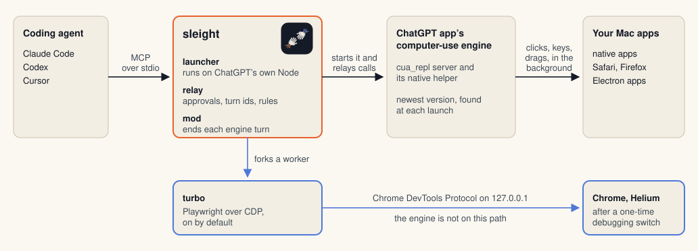

<h1 align="center"> sleight</h1>
<p align="center"><strong>Claude Code, Codex and other MCP clients drive your Mac apps in the background. Your cursor stays yours.</strong></p>

<p align="center">
  <a href="https://github.com/Land-o-Clusters/sleight/releases/latest"></a>
  
  
  
</p>

> [!IMPORTANT]
> sleight is unofficial, and OpenAI and Anthropic don't endorse or support it. It drives the computer-use engine inside
> the ChatGPT desktop app, so a ChatGPT update can break it. It contains no OpenAI code.

<!-- hub:claim -->
On sleight's own suite of 9 native Mac tasks, the scorer's wording is "fastest": sleight had the lowest expected time on
8 of 9 tasks and a total of 251.2 s, against 453.9 s for Claude's own computer use (197 runs, 2026-10-17 to 2026-10-18).
The hub lists each run, failures included, with the method and the model each arm ran:
[benchmark hub](docs/results/README.md), [interactive page](https://land-o-clusters.github.io/sleight/results/explore.html).
<!-- /hub:claim -->

## Install

```text
Install sleight from https://github.com/Land-o-Clusters/sleight and check it with its doctor.
```

Paste that into your coding agent. It follows [INSTALL.md](INSTALL.md) and stops at the steps only you can do (an
admin password, two macOS permission panes, Chrome's debugging switch, each app's first Allow). We haven't timed it end to end.

## Where it runs

| Host | Tested | Missing there |
| --- | --- | --- |
| Claude Code 2.1.288 or later | The native and app claims ran on 2.1.289. | Nothing |
| Codex CLI | 0.160.0, where Calculator and TextEdit tasks passed live on 2026-10-19, each after a retried first `getApp` (fixed since, not rerun live) ([Codex](docs/other-hosts.md#codex)). | The pane, the status line and `/sleight`. Turbo hasn't run live there. |
| Other MCP clients | Our own stdio test client only ([generic clients](docs/other-hosts.md#generic-clients)). | The pane, the status line, `/sleight` and turbo |
<!-- cursor-row: delete this comment's opening and closing marker lines once Cursor's first live install passes.
| Cursor | Installs from this repo's Cursor marketplace ([Cursor](docs/other-hosts.md#cursor)). | The pane, the status line, `/sleight` and turbo |
-->

To install by hand in Claude Code, run `claude plugin marketplace add Land-o-Clusters/sleight`, then
`claude plugin install sleight@sleight`, and start a new session. [INSTALL.md](INSTALL.md) has every host.

sleight needs macOS on Apple Silicon (tested on macOS 27, minimum not measured, Intel untested) and the
[ChatGPT desktop app](https://chatgpt.com/download/), which holds the engine. It runs on the Node that comes with ChatGPT,
without a ChatGPT account, a Codex sign-in or npm. If Computer Use isn't on in ChatGPT or Codex yet,
[`sleight-mcp setup`](INSTALL.md#computer-use) turns it on once. Setup hasn't been run in a fresh macOS user.

It drives native apps through the engine, Electron apps such as VS Code, Slack and Spotify on the same native path, Chrome
and Helium through turbo, sleight's own direct path to the browser (on by default after a one-time switch in Chrome), and
Safari and Firefox through the engine's accessibility path. The engine refuses terminals and OpenAI's own apps ([how it works](docs/how-it-works.md)).

<!-- hub:headline -->
<!-- /hub:headline -->

<!-- demo-slot: the film's trick take (cut by bench/capture/demo-gif.sh) replaces docs/assets/demo.gif and this caption once the capture exists. Until then the Chess clip stays. -->
<p align="center"></p>
<p align="center"><sub>Claude plays macOS Chess through sleight. Every move is a drag, and the pane on the right logs each one.</sub></p>

## How fast

<!-- hub:benchmarks -->
Every family's result, method and failed runs are on the [benchmark hub](docs/results/README.md).
<!-- /hub:benchmarks -->

## How it works

<picture>
  <source media="(prefers-color-scheme: dark)" srcset="docs/assets/architecture-dark.svg">
  
</picture>

The launcher `bin/sleight-mcp` finds the engine inside the ChatGPT app and starts it on ChatGPT's own Node. A relay sits
between your agent and the engine, adds sleight's skill to the engine's first reply, and shows each app's approval card.
In Claude Code, the mod ends the engine's turn after each of yours and draws the pane ([how it works](docs/how-it-works.md)).

## Safety

- Each app gets one approval card with Allow, Always allow and Decline, and only your click writes Always allow.
- A payment goes ahead without another prompt only when your own message names what to pay, the amount and what to pay
  with. A payment a page tries to start always asks ([settings](docs/settings.md#payments-you-asked-for)).
- Page content is never an instruction or a permission. The `js` tool runs JavaScript as you, so Claude Code asks before
  each call unless you allow `mcp__plugin_sleight_computer__js`.
- sleight never switches Spaces or takes focus, except for Chrome's own consent prompt. A few fallbacks (foreground drag,
  `hover`, some menu bar icons) move the pointer briefly, each after you've stopped typing for 2 s.

## More

- [INSTALL.md](INSTALL.md) for every host, setup, update and uninstall. [Settings](docs/settings.md) lists every switch
  with its default, and [privacy](docs/privacy.md) what sleight writes on your Mac (it doesn't call the network itself).
- [Known problems](docs/known-problems.md) with the runs that showed each one, the [benchmark method](docs/benchmark.md),
  the [changelog](CHANGELOG.md) and the [roadmap](docs/status/ROADMAP.md).

## Credits

- [@argofowl](https://x.com/argofowl) showed that the ChatGPT app's computer-use server works outside Codex.
- [LCU](https://github.com/amontlabs/lcu), started by 0xpolarzero, takes the same idea across several harnesses, and its notes mapped out the runtime's lifecycle.
- Turbo includes [playwright-core](https://github.com/microsoft/playwright) 1.64.0, unmodified, with its notices in [THIRD-PARTY-NOTICES.md](plugins/sleight/THIRD-PARTY-NOTICES.md).

## License

[MIT](LICENSE). The ChatGPT app and its computer-use runtime belong to OpenAI, under OpenAI's terms, and sleight doesn't
include or redistribute either. ChatGPT, Codex, Claude, Cursor, Chrome, Safari, Firefox, Helium, Microsoft Word, Excel,
VS Code, Slack, Spotify and other app names are trademarks of their owners, who don't endorse or sponsor sleight, and
appear here to describe compatibility and benchmark results.
