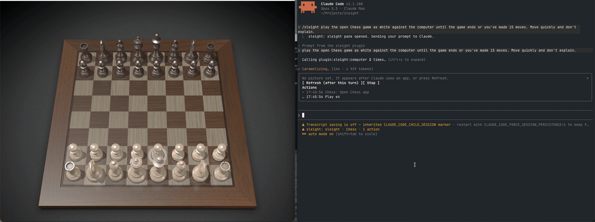

<p align="center"></p>

<h1 align="center">sleight</h1>
<p align="center"><strong>Claude drives your Mac apps in the background. Your cursor stays yours.</strong></p>
<p align="center">A Claude Code plugin that hands Claude the computer-use engine bundled with the ChatGPT desktop app.</p>

<p align="center">
  <a href="https://github.com/Land-o-Clusters/sleight/releases/latest"></a>
  
  
  
</p>

<p align="center">
  <a href="#install">Install</a> ·
  <a href="#why-sleight">Why sleight</a> ·
  <a href="#watch-and-stop-it">Watch and stop it</a> ·
  <a href="docs/settings.md">Settings</a> ·
  <a href="docs/privacy.md">Privacy</a> ·
  <a href="docs/how-it-works.md">How it works</a> ·
  <a href="docs/known-problems.md">Known problems</a> ·
  <a href="docs/benchmark.md">Benchmark</a>
</p>

> [!IMPORTANT]
> sleight is unofficial. OpenAI and Anthropic don't endorse or support it.
> It drives an undocumented runtime that comes with the ChatGPT app, so a ChatGPT update can break it at any time.
> It contains no OpenAI code. It starts the copy already installed on your Mac.

Most computer-use tools borrow your screen. The pointer jumps around, windows pop to the front, and you
sit on your hands until it's done. The engine inside the ChatGPT desktop app sends clicks, drags and
keystrokes straight to the target app instead. The app can be behind your other windows the whole time,
and you keep working. sleight gives that engine to Claude Code.

<p align="center"></p>
<p align="center"><sub>Claude plays macOS Chess against the computer through sleight. Every move is a drag. The sleight pane on the right logs each one.</sub></p>

## Install

You need macOS on Apple Silicon, Claude Code 2.1.288 or later (the oldest version we've tested) and the
[ChatGPT desktop app](https://chatgpt.com/download/), which contains the engine.

```bash
claude plugin marketplace add Land-o-Clusters/sleight
```

```bash
claude plugin install sleight@sleight
```

Or, inside a Claude Code session, `/plugin marketplace add Land-o-Clusters/sleight` and then
`/plugin install sleight@sleight`. Then start a new session.

If you already use Computer Use in ChatGPT or Codex, that's all: the engine's helper and its macOS
permissions are in place.

If you don't, you don't need a ChatGPT account or a Codex sign-in. Run setup once:

```bash
~/.claude/plugins/marketplaces/sleight/plugins/sleight/bin/sleight-mcp setup
```

It runs OpenAI's helper installer, which asks for an administrator's Touch ID or password. Then it opens
the Accessibility and Screen Recording panes, where you allow Codex Computer Use, and checks the
engine with `--doctor`. The engine started and listed apps in a macOS user that never signed in to ChatGPT
(2026-10-10). Setup itself hasn't yet been run in a fresh macOS user. `--doctor` on its own checks an
existing install.

And try it:

```text
Use sleight to open Calculator in the background and work out 12 × 12 by clicking its buttons.
```

The first time Claude touches an app, you get a prompt like *Allow Computer Use to use "Calculator"?*
A yes covers that app for the rest of the session, and "Always allow" covers it from then on. Apps you
marked "Always allow" in Codex or ChatGPT don't ask, because the engine approves them itself
([settings](docs/settings.md#approval-scope)).

### Update

With auto-update on, Claude Code installs each new sleight release by itself. Turn it on once from
`/plugin` in a session: the **Marketplaces** tab, sleight, **Enable auto-update**. Claude Code leaves it
off for marketplaces outside Anthropic's own.

To update now, pick **Update marketplace** in the same place, or run:

```bash
claude plugin marketplace update sleight && claude plugin update sleight@sleight
```

Then start a new session. A running session keeps the version it started with.

Also runs as a plain MCP server: see [other hosts](docs/other-hosts.md).

### Turbo browser path (on by default)

Turbo adds `browser_open`, `browser_read`, `browser_act` and `browser_fill` through a direct browser
connection. The engine's browser tools stay beside them. Claude can choose either path, including the
engine's mobile viewport tools. Each path uses its own tabs and refs. An uncertain action or safety
refusal must not be retried through the other path.

Turbo is on after install, with one step from you. When a session starts, sleight finds Google Chrome
(then Helium), writes `~/Library/Application Support/sleight/turbo.json` for the installed plugin, and
rewrites it after a plugin update or a node change. Then turn on remote debugging in the browser once,
at `chrome://inspect/#remote-debugging`. Chrome asks you to allow each connection. If it isn't on yet,
the engine's browser path is used.

```bash
sleight-mcp turbo status                        # on or off, the browser, and whether remote debugging is on
sleight-mcp turbo off                           # turn turbo off; sleight never turns it back on
sleight-mcp turbo on [--browser chrome|helium]  # turn it on, or pick the browser
```

`sleight-mcp --doctor` starts with a turbo section that lists each problem with its fix. Turbo's native
helpers compile from checked source on first use, requiring Apple's command-line tools. A failed build
leaves the engine available. The plugin includes `playwright-core` 1.64.0 with its hashes and license
notices, loaded only for turbo. Native apps still use the ChatGPT engine.

On FowlBrowser's 13 browser tasks (2026-10-16, Haiku 5.5 at high effort, five rounds, both browser
orders), turbo's median round took 547 s (p90 590) with 0 errors against FowlBrowser's 720 s (p90 868)
and 7 errors, 76% of its time. Both finished 26/26 under the owner's scoring. On Opus 5.5 it took 675 s
against 885 s, 76% again ([gate](docs/benchmarks/2026-10-16-gate.md),
[Opus](docs/benchmarks/2026-10-16-opus.md)). That covers FowlBrowser's tasks only, not native apps.
Installed setup and native consent still need qualification (see [known problems](docs/known-problems.md#turbo-on-by-default)). The earlier
[prototype](docs/benchmarks/2026-10-14-turbo-prototype.md) passed 4/9 and skipped production consent.

## Why sleight

- Your Mac stays yours. Clicks, typing and drags go to the app itself, behind your other windows.
  When acquiring an app launches it, sleight puts your front app back. Only a few fallbacks borrow
  the pointer, and each asks first. On the engine's browser path, script popups still took focus
  18 times in 26 runs (2026-10-13). [What works in the background](docs/background.md)
  lists each kind of action with the runs that measured it.
- Several agents can share one Mac. Input leases give one session a window at a time and tell the
  others who holds it. With two sessions typing into one document, text doubled in 5/5 trials
  without leases and appeared once, with one refusal, in 5/5 with them (0.6.0).
- It checks element numbers before it clicks. When a window renumbers, an action goes to the
  element Claude saw at its new number, and stops when sleight can't tell which one it is. In a
  0.10.0 pass this caught two clicks that would have hit the menu item next to the intended one.
- It's light on context. After each action Claude gets only what changed. On the CNN front page,
  scrolling down five times sent 39,655 characters instead of 203,160 (0.10.0). A browser tab's
  tree is capped, with a note on reading the rest.
- It asks once per app per session, unless you chose "Always allow" in its prompt or in Codex or
  ChatGPT. Terminals and OpenAI's apps work once you lift the engine's refusal with one setting,
  and their prompt says the app could be dangerous.
- It's faster than Codex on the same engine. Against native Codex computer use (1.2.0, the owner
  away), both passed 9/9 and sleight took 22.0 s a run against 44.6 s, at 4.68 against 4.84 CPU
  seconds. On 12 browser tasks in Safari and Helium both passed 24/24, at 28.5 s against 41.8 s.
  In the [native guard A/B](docs/benchmarks/2026-10-14-guard-ab.md), the combined changes passed
  15/15 against 14/15, with tool time 32.5 s against 49.9 s (summed medians, five tasks, three runs
  a side). After safety fixes, 14/14 passed with one skipped run and 43.9 s of tool time.
- The benchmark results are published with their failures. The 1.1.0 release pass passed 20/21;
  1.2.0 was released on the head-to-heads above, without a full release pass. On FowlBrowser's 13
  browser tasks, sleight's engine path passed 23/26 and then 21/26 against FowlBrowser's 26/26,
  with every miss a form ([2026-10-13](docs/benchmarks/2026-10-13-gate.md)).
  TODO: 1.3.0's full release pass result. Every pass on the way is
  published too, including one at 13/21 run while the apps were on another Space (the 2026-10-08
  Split View pass), and Chess in the 1.0.0 head-to-head, which sleight lost 0/3 to 2/3.

sleight also does what the engine can't. It drags text, which the engine's own drag fails to move,
and reaches menu bar icons and notification banners. Each of these needs its own approval.

On engine browser tabs, `sleight.fillForm` fills without submitting, `sleight.pickFromList` picks from a
virtualized list and `sleight.reorder` puts a list in order. `sleight.dragTo` aims inside an HTML5
list target so the page sees the drop. With it, the settings form took 39 s instead of 313 s
([2026-10-12](docs/benchmarks/2026-10-12-fowlbrowser-h2h-2.md)).

## Compared with Claude's own computer use

Claude Code has a built-in computer use server, and the Claude desktop app has the same engine.
Anthropic's [documentation](https://code.claude.com/docs/en/computer-use) (read 2026-10-04) says it
controls your screen: other visible apps are hidden while Claude works and come back when the turn
ends. Only one session can use the computer at a time, and it holds the lock until the session exits.
Claude sees the screen through screenshots.

sleight sends events to the app itself, which can be behind your other windows. Your other apps stay
visible, and you keep using the Mac while Claude works. Several sessions can use sleight at once:
we've run two sleight sessions together, and sleight next to Codex. Claude reads each app's
accessibility tree as well as screenshots. Foreground `drag` fallback, `hover` and some `menu_bar`
actions briefly take the pointer.

Claude's own computer use is supported by Anthropic and also runs on Windows in the desktop app.
sleight is unofficial and depends on the ChatGPT app's engine.

## Watch and stop it

The apps sleight drives stay in the background, which also means you can't see them. On Claude Code
2.1.287 or later, which added the turn-end hook these run on, you get three ways to keep an eye on
things.

`/sleight` opens a pane with the app's latest picture and a log of every action Claude took. Anything
after it goes to Claude as a prompt, so `/sleight play chess in the background` opens the pane and starts
the task. The picture refreshes after each turn that used sleight, or when you press Refresh (`r`) while
Claude is idle. A terminal draws it in colored half-blocks. The desktop app's Code tab shows the
screenshot itself.

The status line shows which app Claude is working in and how many actions it has taken.

Set `SLEIGHT_RECEIPTS=1` to write private receipts in `~/Library/Logs/sleight/receipts/` and show
the latest one's path in the pane. Receipts are off by default. They list actions, targets, call outcomes
and observed changes, with text inputs, single printable keys and window titles redacted.
Each write keeps at most seven days or 200 receipt files, whichever is fewer.
Optional unsaved review lists changed windows and observed native Undo or Revert controls.
The [settings](docs/settings.md#receipts-and-unsaved-review) explain title redaction and review.

`/sleight stop`, or Stop (`s`) in the pane, works mid-turn. It ends the engine's turn and refuses every
further sleight call until your next message. The call in progress is cut off, which usually ends Claude's turn. If Claude keeps working without sleight, press Esc.

The pane waits for Claude to finish before it takes a picture. The engine reports UI changes as a diff
against the latest read of an app, no matter who made that read, so a snapshot mid-turn could hide a
change from Claude. When the pane does read an app, your next message tells Claude to take a full read
before relying on a diff.

## Replay a run

A run Claude finished can run again with no model, through the same guards. In the desktop app's
Code tab or a terminal session:

```text
/sleight record task.json
/sleight replay task.json
```

`record` saves this session's successful sleight calls and never replaces an existing file. Replay
uses the session's approvals and input lease and logs each step in the pane. It stops at the first
step the app isn't ready for, and Claude then gets what stopped and finishes the task. Stop in the
pane cancels a replay. The pane has buttons for both, too.

From a shell, you can record an older session:

```bash
~/.claude/plugins/marketplaces/sleight/plugins/sleight/bin/sleight-mcp record <session id> task.json
```

```bash
~/.claude/plugins/marketplaces/sleight/plugins/sleight/bin/sleight-mcp replay task.json
```

The session id is the transcript's file name under `~/.claude/projects`. The shell replay asks in
the terminal before using an app you haven't pre-approved.
[How it works](docs/design/replay.md).

Scheduled runs use `sleight-mcp routine add task.json --every 15m`. The command prints the job;
type `install` in the terminal to install it. `routine list`, `routine run-now <id>` and
`routine remove <id>` manage it. Removal asks for `remove` in the terminal. Runs wait for two minutes
idle and require existing app windows. A stop pauses scheduled runs and sends a notification with
the private log path. Only literal background steps in apps on your preapproved list can run.
[Routine design and limits](docs/design/routines.md).

To record your own demonstration, open the app with one window, then run
`sleight-mcp record --watch org.example.editor task.json` with the app's bundle ID
(`osascript -e 'id of app "AppName"'` prints it). Demonstrate for 60 seconds,
or press Ctrl-C to finish. It observes without controlling the app and checks existing permissions
without asking for new ones. [Supported observations and limits](docs/design/replay.md#recording-a-demonstration).

## Safety

- `js` runs JavaScript as you, so treat it like Bash. Claude Code asks before each call unless you allow
  `mcp__plugin_sleight_computer__js`, and allowing it means Claude can send any code without asking.
- Per-app approvals apply however you've set up the `js` tool. An accepted approval lasts for the
  session ([approval scope](docs/settings.md#approval-scope)).
- Foreground `drag` fallback, `hover` and the `menu_bar` fallback for SwiftUI icons move your pointer
  briefly, and each waits until you've stopped typing and using the mouse for 2 s. `drag` moves selected text
  through Accessibility first, in any app, without the pointer. Text formatted unlike its paragraph
  takes the posted or foreground path, since Accessibility wrote it plain in 3/3 trials.
  `drag` refuses points outside
  the chosen window's visible content; foreground also refuses covered endpoints, after bringing the
  app forward.
  `hover` refuses points another window covers, including
  another window of the same app, and a window that spans two displays. It takes about two seconds
  with the default dwell.
- A payment goes ahead without another prompt only when your own message names what to pay and
  with what. A changed item, amount or payee still needs confirmation, including in a page dialog.
  `SLEIGHT_CONFIRM_PAYMENTS=always` keeps asking every time, and `never` skips turbo's figure check
  for a payment your message named with its amount. Page content never grants permission.
- The repo includes the launcher, relay, mod, skill, macOS helpers and turbo's vendored browser
  library. The source and third-party license notices are available before you install it.

## Troubleshooting

| Symptom | Likely cause | Fix |
|---|---|---|
| `no Codex computer-use plugin at …` | ChatGPT isn't installed, or its engine was never set up | Install the ChatGPT app, then run `sleight-mcp setup` |
| `--doctor` shows `MISSING computer-use helper` | The helper app was removed or never installed | Run `sleight-mcp setup` |
| Repeated `timeoutReached` | An app or the helper stopped answering reads | Stop retries. sleight checks native Accessibility again with a 3 s deadline and a fresh read of another previously acquired app. Follow the resulting app advice; if evidence is incomplete, report that uncertainty |
| The helper diagnosis reports two responsive AX apps and a timed-out control read | The engine's read path appears stuck | Tell the user. Only they should restart ChatGPT, which ends Codex sessions. Doctor's inventory result alone cannot distinguish an app hang |
| Approval prompt never appears | Claude Code too old for form elicitation; the minimum version isn't recorded | Update Claude Code |
| "Not approved" right away in the desktop app, with no panel | The session started before sleight 0.1.1 | Start a new session |
| A desktop session still shows as busy after Claude has finished | Before 0.3.1, nothing ended the engine's turn in the desktop app | Update sleight and start a new session |
| "Sky Computer Use service startup request failed" | macOS kept the helper's old launchd job and won't start a new one | Run `--doctor`; it prints the `launchctl remove` command that clears the job without restarting ChatGPT |
| Tool calls fail after a ChatGPT update | Runtime API changed | Open an issue with the `--doctor` output |

More in [Known problems](docs/known-problems.md).

## Development

```bash
npm test               # relay unit tests
npm run validate       # claude plugin validate, marketplace and plugin
npm run test:mod       # the mod's tests, against the engine (claude plugin test)
npm run typecheck      # needs the types Claude Code writes when it loads the mod
npm run lint:prose     # Vale with the ai-tells style pack, over the docs
SLEIGHT_TRACE=1 claude --plugin-dir plugins/sleight   # logs every relayed message to ~/Library/Logs/sleight/
```

### Update watch

`scripts/watch.sh` runs `--doctor` and saves the engine's runtime API docs to
`~/Library/Logs/sleight/engine-api-<version>.md`. The capture calls `getApp` with a bundle ID that
doesn't exist, so it doesn't touch an app or prompt for approval.
When the version changes, it writes `engine-api-<version>.diff` against the previous snapshot and runs
one benchmark task, with the diff path in the macOS notification (the first run saves a baseline).
It logs to `~/Library/Logs/sleight/watch.log` and also notifies when a check fails; an older watch
without a previous snapshot reports that the diff is unavailable.

```bash
npm run watch            # check now
npm run watch:install    # run it every Monday at 9:00 (a launchd job)
scripts/watch-install.sh --daily   # or every day at 9:00
npm run watch:remove     # remove the job
```

The benchmark task auto-approves Calculator, like any benchmark run.

## Roadmap

The full plan, in order, is in [docs/status/ROADMAP.md](docs/status/ROADMAP.md). Features, done and
open:

- [x] MCP server that survives ChatGPT updates
- [x] Session and turn ids, so the engine can scope approvals and cleanup
- [x] Approvals that last for the session, as in Codex
- [x] Hide or block the engine's internal tools for Claude
- [x] A skill that tells Claude when to use sleight and when to fall back to a pointer-moving tool,
  delivered with the engine's first result so it costs no turn
- [x] Per-turn cleanup through the mod's `turn.complete` hook
- [x] Live pane with the app's latest picture and an action log
- [x] Status line entry and `/sleight stop`
- [x] Hover workarounds in the skill
- [x] A reproducible task benchmark
- [x] Weekly update watch
- [x] Approvals in the desktop app's Code tab, through sleight's own panel
- [x] Menu bar icons and notification banners, which the engine leaves out
- [x] A fair benchmark against LCU, with each arm checked to load only its own tool
- [x] Text drags: a drag of sleight's own that holds the mouse down and moves in steps
- [x] TextEdit drags in the background, with verified text readback and foreground fallback
- [x] The pane and status line in the desktop app's Code tab
- [x] `/sleight stop` checked in the desktop app's Code tab (2026-10-11, mid-call: the turn ended at once)
- [ ] Windows, parked for now. Codex computer use reached Windows on 2026-05-29 (foreground only); a port is unchecked
- [x] Approve one document instead of a whole app (`SLEIGHT_APPROVAL_SCOPE=document`, a guard against
  mistakes rather than a security boundary)
- [x] Review saved-file changes and choose Keep or Undo through a user prompt
- [ ] Review unsaved changes and app state without backing files
- [x] Rules for what data may move from one app to another (`SLEIGHT_FLOW_RULES=1`, a guard against
  mistakes rather than a security boundary)

## Credits

- [@argofowl](https://x.com/argofowl) showed that the ChatGPT app's computer-use server works outside Codex.
- [LCU](https://github.com/amontlabs/lcu), started by 0xpolarzero, takes the same idea across several harnesses, and its notes mapped out how the runtime's lifecycle works.
- The icon started as an image from ChatGPT's image generation.

## License

[MIT](LICENSE). The ChatGPT app and its computer-use runtime belong to OpenAI, under OpenAI's terms.
sleight doesn't include or redistribute either.
