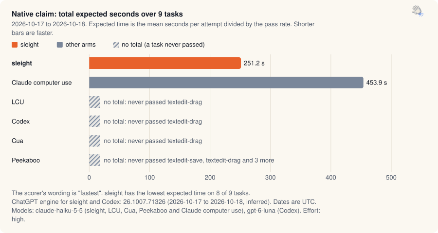
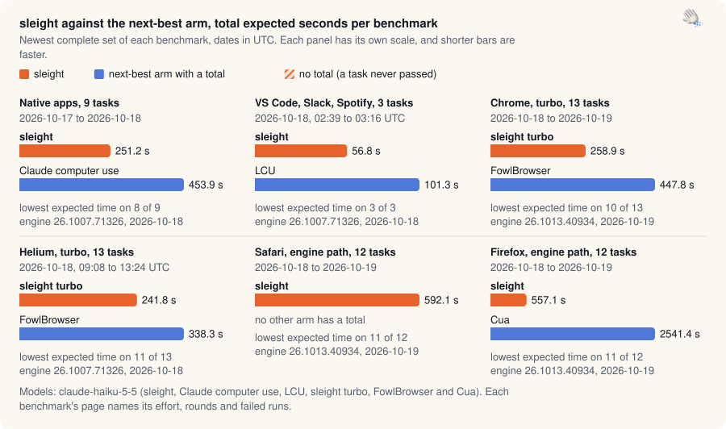

Benchmarks · [Native](native-claim.md) · [Apps](app-claim.md) · [Chrome and Helium](browser-turbo.md) · [Safari and Firefox](browser-race.md) · [Experiments](ab-tests.md) · [Releases](release-passes.md) · [Insights](insights.md) · [Interactive](https://land-o-clusters.github.io/sleight/results/explore.html)

# Benchmark results

Every benchmark sleight has published, one page per family. Each page leads with its results and folds the method underneath: models, effort, runs per arm, scoring and loss rules, arm versions, and what was left out and why. `bench/results-hub.mjs` computes every number from the raw results with the same scorers the claims use, and failures are published with the passes.

<picture>
  <source media="(prefers-color-scheme: dark)" srcset="img/headline-native-dark.svg">
  
</picture>

<sub>Native claim, 2026-10-17 to 2026-10-18: sleight's total expected time over 9 tasks is 251.2 s against Claude computer use at 453.9 s, and LCU, Codex, Cua and Peekaboo have no total because each never passed at least one task.</sub>

<picture>
  <source media="(prefers-color-scheme: dark)" srcset="img/overview-dark.svg">
  
</picture>

<sub>Total expected seconds of sleight against the next-best arm with a total, in the newest complete set of each benchmark. Native apps, 251.2 s against Claude computer use at 453.9 s. VS Code, Slack, Spotify, 56.8 s against LCU at 101.3 s. Chrome, turbo, 258.9 s against FowlBrowser at 447.8 s. Helium, turbo, 241.8 s against FowlBrowser at 338.3 s. Safari, engine path, 592.1 s, and no other arm has a total. Firefox, engine path, 557.1 s against Cua at 2541.4 s.</sub>

The [interactive page](https://land-o-clusters.github.io/sleight/results/explore.html) has the same data with sorting, filters and a chart per task. Its source is [explore.html](explore.html) in this folder.

| Family | What it measures | Where it stands | Data |
| --- | --- | --- | --- |
| [Native claim](native-claim.md) | The 9 native Mac app tasks, sleight against LCU, Codex, Cua, Peekaboo and Claude's own computer use. | "fastest", sleight's total expected time 251.2 s over 9 tasks (197 runs, 2026-10-17 to 2026-10-18; engine 26.1007.71326, 2026-10-17 to 2026-10-18) | [json](data/native-claim.json) |
| [App claim](app-claim.md) | VS Code, Slack and Spotify tasks with the same arms. | "fastest", sleight's total expected time 56.8 s over 3 tasks (60 runs, 2026-10-18, 02:39 to 03:16 UTC; engine 26.1007.71326, 2026-10-18) | [json](data/app-claim.json) |
| [Chrome and Helium: turbo against FowlBrowser](browser-turbo.md) | Turbo in Chrome and Helium, in the real-window race and the earlier gate rounds. | Chrome lowest expected time on 10 of 13, total 258.9 s against FowlBrowser's 447.8 s (`sleight-turbo-rel130`). Helium lowest expected time on 11 of 13, total 241.8 s against FowlBrowser's 338.3 s (`sleight-turbo-b5`). 14 gate studies. Engine 26.1007.71326, 2026-10-18; engine 26.1013.40934, 2026-10-19 | [json](data/browser-turbo.json) |
| [Safari and Firefox: the engine path against Codex, LCU, Cua and Peekaboo](browser-race.md) | sleight's engine path in Safari and Firefox against Codex, LCU, Cua and Peekaboo. | Safari "fastest" (`sleight-b10`, 2026-10-18). Firefox "fastest" (`sleight-b10`, 2026-10-18). Engine 26.1007.71326, 2026-10-18; engine 26.1013.40934, 2026-10-19 | [json](data/browser-race.json) |
| [Experiments](ab-tests.md) | sleight against sleight, for skill, wording, tool and turbo changes. | 13 studies with run data, 94 write-ups in all | [json](data/ab-tests.json) |
| [Release passes and the earlier head-to-heads](release-passes.md) | The per-release regression passes and the first native head-to-heads. | 7 release passes (2026-10-05 to 2026-10-09), 115 results files in all | [json](data/release-passes.json) |

[Insights](insights.md) (being written) covers what the runs taught us about run-to-run variation, Haiku against Opus, which tuning paid off, and engine quirks.

## Terms

- Expected time is the mean seconds per attempt divided by the pass rate, the time to a correct result if failed attempts are retried.
- An arm is one agent setup: sleight, a competitor plugin, or a sleight variant in an A/B.
- A round runs every task once per arm. A claim or race task gets 3 runs per arm, or 5 where sleight and another arm are within 20%.
- The full rules are in [LAWS](../status/LAWS.md), and the tasks and harnesses in [benchmark.md](../benchmark.md).

<details><summary>Rebuild</summary>

```sh
node bench/results-hub.mjs                # collect from the raw folders this Mac has, then render
node bench/results-hub.mjs --render-only  # render from docs/results/data only
node bench/results-hub.mjs --check        # exit 1 if a page, data file or README block would change
```

The raw claim and race folders live outside the repo, in `~/Projects/sleight-wt/app-claim` and `~/Projects/sleight-wt/race-1017`. On a Mac without them, the generator keeps the data files already here. `--wt <dir>` points it at another copy.

</details>

Each arm table names the ChatGPT engine versions its runs used, with their UTC dates. Rebuild every page with `node bench/results-hub.mjs`.

Benchmarks · [Native](native-claim.md) · [Apps](app-claim.md) · [Chrome and Helium](browser-turbo.md) · [Safari and Firefox](browser-race.md) · [Experiments](ab-tests.md) · [Releases](release-passes.md) · [Insights](insights.md) · [Interactive](https://land-o-clusters.github.io/sleight/results/explore.html)
